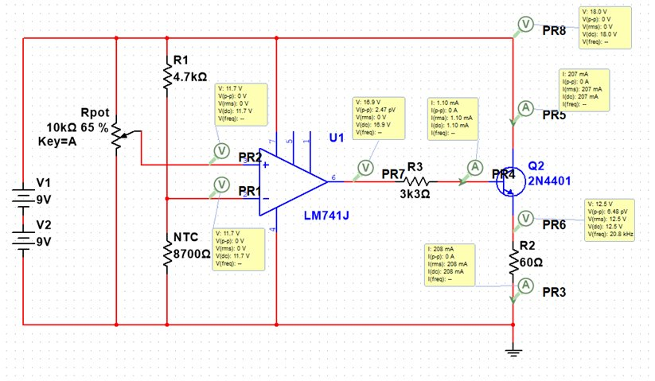
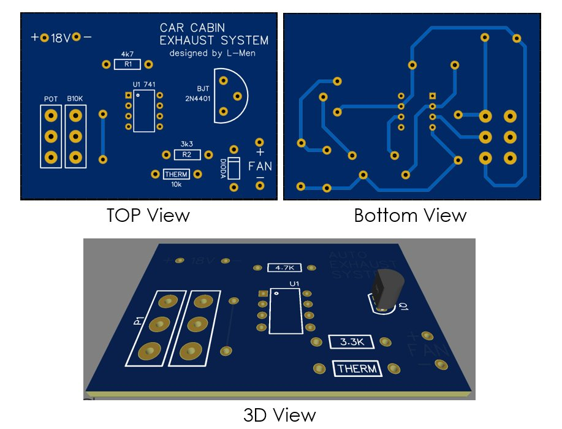
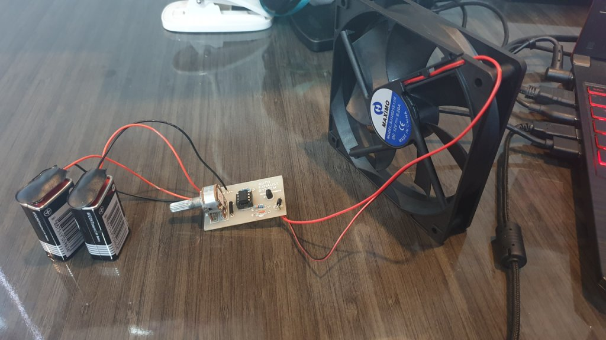

> 本项目为我本科第三学期《电路与信号》和《电子器件》课程的期末考试提交作品。

## 背景

雅加达的气温最高可达 34°C。在阳光直射下，停放车辆的车内温度更加危险，甚至可达到 70°C。此外，车内材料发生的化学反应也可能引发热射病和癌症。

## 解决方案

我们设计了一种简单的模拟电路系统，用于排出车内气体。当车内温度达到 28°C 时，风扇将自动启动，将车内空气强制排出。

## 原型

