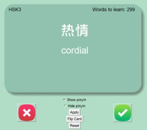
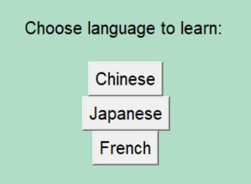
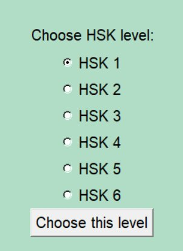
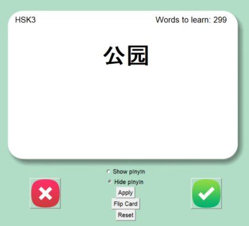

> 本项目是我基于在线课程所学习的闪卡（flashcard）应用进行的改进版本。

| | |
|---|---|
|  |  |

## 背景

学习一门新语言最困难的部分之一是词汇积累。对于母语使用拉丁字母的人来说，如果目标语言使用不同书写系统，这一过程会更加困难。

以普通话为例，它使用的文字是汉字（hànzì）。汉字可以说是学习普通话过程中最大的挑战之一。虽然普通话有汉语拼音这一罗马字母转写系统（pīnyīn），但拼音主要用于学习阶段，学习者仍然需要掌握汉字本身。

## 动机

我开发这个闪卡项目的初衷是为了学习普通话，同时也展示一些 Python 编程能力。幸运的是，我在 Udemy 上学习的一门课程（[100 Days of Code](https://www.udemy.com/course/100-days-of-code)，这门课很不错）介绍了闪卡应用的基本框架，于是我在此基础上进行了修改，使其可以同时用于学习日语和普通话。

## 结果

以下是应用的一些截图：

| | | |
|---|---|---|
|  |  |  |

源码： [Github](https://github.com/richardmedyanto/language-flashcard)
