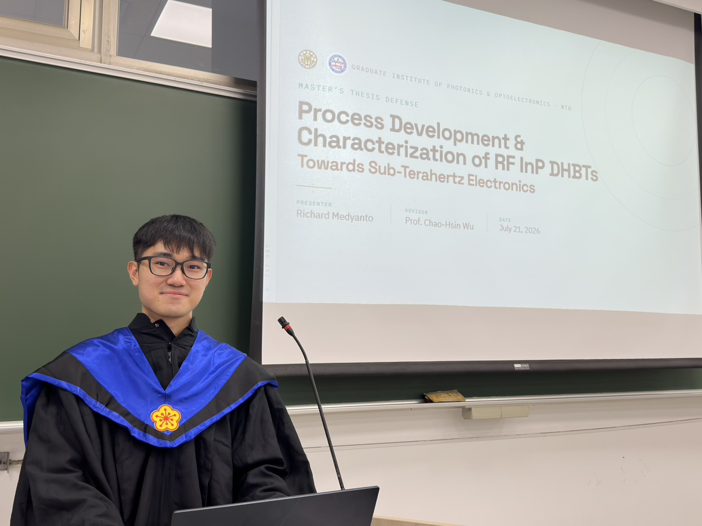

經過兩年的學習，我終於可以說，我從國立臺灣大學（NTU）碩士畢業了！

回頭看，這兩年經歷了不少事情。我原本學的是機器人與汽車工程，所以剛入學時，幾乎沒有半導體方面的基礎。我想，我的指導教授吳肇欣也很清楚這一點。但他仍然給了我一個機會，讓我加入他的實驗室，並在這一路上教會了我很多。我也非常感謝學長姐們，他們耐心地帶著我學習那些對我來說完全陌生的知識和技術。

在臺灣讀書，有一點讓我印象特別深刻：這裡的學術體系為學生提供了很好的支持，尤其是在研究方面。身為碩士生，我們不只是上課、學習理論，還有機會在實驗室裡動手實作，參與有意義的研究。這兩年間，我從幾乎不了解半導體製程，到親手操作微影、蝕刻、沉積和元件特性分析等製程與技術。過程並不總是順利，但能把課堂上學到的知識用在實際研究中，大概是這段求學經歷裡最有成就感的部分之一。

我也很感謝自己有機會參加在臺灣和韓國舉辦的學術研討會。在那裡，我認識了來自世界各地的研究人員，了解了他們的工作，也看到了這個領域還有多少值得探索的問題。

碩士班接近尾聲時，我還有機會訓練學弟妹，讓他們接著做我一直在做的研究。從一個幾乎事事都需要別人指導的人，變成教別人做研究的人，這樣的轉變讓我覺得有些不可思議。看到自己的改變，我才意識到，這兩年裡原來已經學到了這麼多。

不過，除了課業和研究，讓這段經歷如此特別的，還是遇到的人。我結識了許多很好的朋友，與優秀的同事一起工作，也向真心關心學生的教授們學習。一路上確實遇到過不少挑戰，但我依然十分珍惜這段經歷。

出國留學是我做過最好的決定之一。來到臺灣時，我只是希望能學到一些新東西，而離開時，我帶走的遠不只一張學位證書：還有新的知識、實務技能、難忘的回憶，以及希望能維繫一輩子的友誼。我真的很感謝每一位陪我走過這段旅程的人。謝謝你們，讓這兩年如此難忘！

📸 這是我順利通過碩士論文口試後拍的照片。

